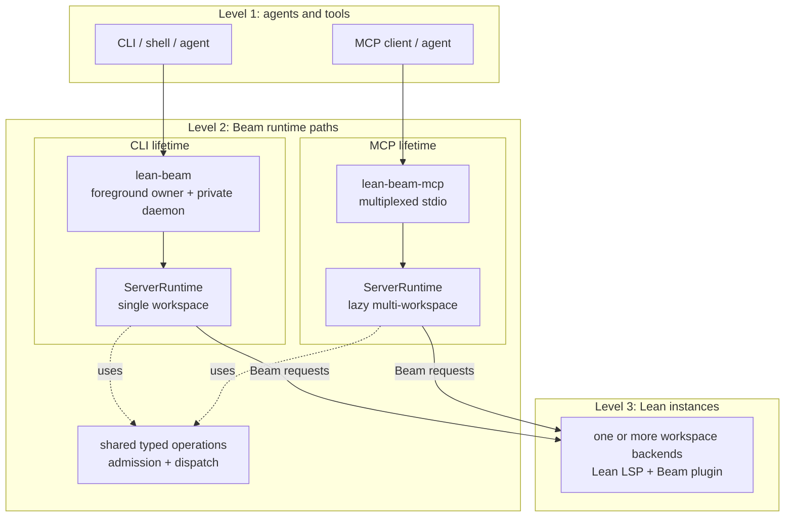

# Lean Beam

Lean Beam gives AI agents and other tools an efficient way to work with Lean projects. It exposes
Lean language-server extensions through a [`lean-beam` CLI](docs/SETUP.md#use-beam-from-a-lean-project)
and an [MCP server](docs/SETUP.md#mcp-setup), keeping Lean's module context available across requests.

Beam supports:

- **Speculative execution:** try commands and tactics in a file's context without changing its
  source, using [`runAt`](docs/STATUS.md#core-lean-surface). Independent attempts can run concurrently.
- **Multi-file work:** [checkpoint edited dependencies and refresh their importers](docs/SETUP.md#work-across-files)
  so later files can use their changes.
- **Saving from the running Lean context:** [`save`](docs/SYNC_AND_DIAGNOSTICS.md#command-model)
  writes a module checkpoint from the state already checked by the Lean server, without batch
  re-elaboration.
- **Diagnostics and pending work:** [`sync`](docs/SYNC_AND_DIAGNOSTICS.md#command-model) waits for
  current diagnostics and readiness; [`todo`](docs/STATUS.md#core-lean-surface) finds sorries, holes,
  diagnostics, code actions, and incomplete proofs.
- **Inspection and navigation:** proof goals, hover and signature help, definitions, references,
  and document/workspace symbols.

We have found Beam useful for proof repair, proof search experiments, proof translation and porting,
autoformalization experiments, and regular AI-assisted Lean editing.

Before an external workspace build, stop all affected CLI owners, drop any affected MCP workspaces,
and confirm their cleanup. The [batch-build procedure](skills/lean-beam/references/workflow-details.md#before-a-local-batch-build)
explains how to keep builds separate from retained Beam state.

Beam is implemented in Lean. CLI and MCP share broker code and typed operations, while each owns
its transport and runtime lifetime:



CLI clients use the project daemon owned by a foreground `lean-beam serve` process. An MCP client
launches `lean-beam-mcp`, which manages its workspace sessions directly; it does not attach to the
CLI daemon.

Beam is beta software, and its interfaces may change. See [Status](docs/STATUS.md) for current
capabilities and limitations, and [Compatibility](docs/COMPATIBILITY.md) for supported targets.

## Install and connect your agent

Lean Beam is distributed in two ways:

- **A Lean toolchain that includes Beam:** follow [bundled Beam setup](docs/SETUP.md#use-beam-bundled-with-lean).
  Use the commands provided by that toolchain for projects using the same Lean installation.
- **A standalone installation:** on Linux or macOS, follow [checkout installation](docs/SETUP.md#install-beam-from-this-checkout)
  with `elan` on `PATH`. The installer offers toolchains, agent skills, and MCP client registration.

Windows support is [experimental](docs/STATUS.md#distribution). Native builds and CI do not
establish an official elan Windows distribution path; that distribution is deferred pending the
libuv investigation and fixes.

Bundled binaries do not install an agent skill. For either distribution, install the
[Lean agent skill](docs/SETUP.md#install-the-lean-skill-manually) from the matching Beam release,
including its `references` directory, in your client's skill directory. To use MCP, also register the installed
`lean-beam-mcp` command with your client; see [MCP setup](docs/SETUP.md#mcp-setup).

For Codex or Claude, the installer can install the skill and register MCP together. Pi uses the
CLI skill:

```bash
./scripts/install-beam.sh --codex --codex-mcp
./scripts/install-beam.sh --claude --claude-mcp
./scripts/install-beam.sh --pi # CLI skill only
```

At the toolchain prompt, select the Lean versions used by your projects. The default is Beam's
own pinned toolchain, which may differ from your project's version.

The standalone installer puts commands in `~/.local/bin`; make sure that directory is on `PATH`.
Beam is installed once for your agent tools; you do not add it to each project's lakefile.
For OpenCode, Mistral Vibe, manual MCP registration, additional toolchains, and offline setup, use
[the setup guide](docs/SETUP.md). Toolchains are selected when installing; runtime requests do not
build missing Beam components.

### Verify the connection

Restart your agent client after installation or a registration change so it reloads its server
configuration. In a new agent session, confirm that the Lean skill is available.
[Client configuration checks](docs/SETUP.md#inspect-client-configuration) can
diagnose missing files but cannot prove that a running client loaded the skill.
From the Lean project, use `lean-beam --version` and `lean-beam doctor` to
inspect the selected installation and project setup. For bundled commands, use the same
`elan run SELECTOR` prefix described in [bundled setup](docs/SETUP.md#use-beam-bundled-with-lean).

For MCP, use the client's connected tools to call `beam_version`, then `lean_sync` for an existing
Lean file with its absolute workspace root. The first identifies the running server; the second
checks the client-to-Lean request path. See [MCP verification](docs/SETUP.md#verify-the-mcp-server)
for details. A running server retains its original installation even after a launcher is updated;
checking a newly launched command does not establish which version an existing client is using.

Before upgrading, stop existing sessions through their original installation and wait for cleanup.
Follow [the upgrade guide](docs/SETUP.md#before-an-upgrade), then restart clients against the new
installation.

## Documentation

For users and agents:

- [Setup](docs/SETUP.md): installation, agent skills, MCP registration, verification, and recovery.
- [Agent workflow](skills/lean-beam/SKILL.md): commands, positions, versions, and outcomes.
- [Trust and proof confirmation](skills/lean-beam/references/trust-and-validation.md): checkpoints,
  batch builds, and independent proof confirmation.
- [Status](docs/STATUS.md), [Compatibility](docs/COMPATIBILITY.md), and
  [custom toolchains](docs/CUSTOM_TOOLCHAINS.md): capabilities, limitations, and supported targets.
- [Changelog](CHANGELOG.md): release changes.

For contributors and integrators:

- [Contributing](CONTRIBUTING.md) and [agent instructions](AGENTS.md): repository workflow.
- [Development](docs/DEVELOPMENT.md): architecture and maintainer guidance.
- [Toolchain bundling](docs/TOOLCHAIN_BUNDLING.md): native runtime construction and distribution.
- [MCP](docs/MCP.md) and [Sync and diagnostics](docs/SYNC_AND_DIAGNOSTICS.md): protocol contracts.
- [Testing](docs/TESTING.md): suites and coverage.

Beam is for non-adversarial development. Speculative requests isolate Lean elaboration state;
they do not provide an OS sandbox for Lean IO. See
[sandbox permissions](docs/SETUP.md#sandbox-and-network-permissions).

Rocq goal probes and the Rocq agent skill live in the separate, frozen
[rocq-beam](https://github.com/ejgallego/rocq-beam) project.

## Help and feedback

Bug reports, design feedback, and documentation improvements are welcome through
[GitHub issues](https://github.com/leanprover/lean-beam/issues) or
[Lean Zulip](https://leanprover.zulipchat.com).

For a structured bug report, use `lean-beam feedback-report --stdin` as described in the
[feedback guide](docs/FEEDBACK.md). Beam returns the report locally. Review it before sharing;
for a non-public workspace, set `"confidential": true` in the input and share only privately.

## License

Apache-2.0. See [LICENSE](LICENSE).
